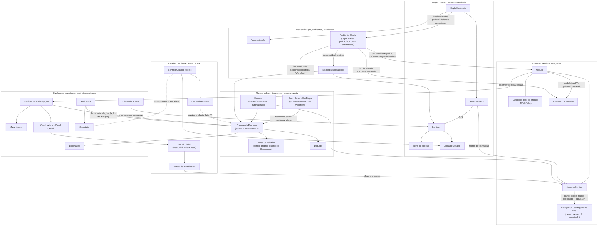

# 04 - Modelo-alvo dos dados do preset

> [!info]- Navegação
> **Índice da iniciativa:** [[../../Conhecimento/0 - SGV-11262 - Índice|Índice da SGV-11262]] · **Roadmap:** [[../../Roadmap - Modelo de atores e preset do TR|Roadmap — Modelo de atores e preset do TR]] (passo 9) · **README do card:** [[../00 QA/00 README|README]] · **Mapa geral:** [[00 - Mapa geral]] · **Matriz:** [[01 - Matriz de atores e relações]] · **Visão consolidada (evidência atual):** [[02 - Visão consolidada do preset candidato]] · **Triagem/caminho-base:** [[03 - Triagem dos itens sem fatia (passo 8)]]

> [!important] Modelo revisado e aprovado pelo Rafael/Codex (13/10/2026) — deriva necessidades do TR/produto; não atribui canal de fornecimento
> Esta nota modela, por entidade, os atributos, estados e relações necessários aos cenários de sanidade do TR completo (1.1–1.43), com origem rastreável no TR e na documentação de produto. Ela **não** decide se cada dado vem do `.env` individual de cada QA, do seed persistente ou de um estado criado durante o cenário — esse mapeamento campo a campo é o passo 10 do Roadmap, registrado em [[05 - Matriz de fornecimento dos dados]]. O seed/testes atuais (fatias 02–18, consolidadas em [[02 - Visão consolidada do preset candidato|02]]) são evidência de referência sobre a automação de hoje, não limite deste modelo. Esta nota não cria CTs nem implementa seed.

## 1. Como ler este modelo

Cada grupo abaixo corresponde a um dos 6 agrupamentos temáticos já usados em [[00 - Mapa geral|Mapa geral]] (C1–C6), pra manter a mesma organização visual já aprovada. Por entidade/ator:

- **Atributos/estados necessários** — o que o cenário de sanidade precisa que a entidade tenha, derivado do texto do TR e, quando o TR não detalha, da documentação de produto (Conhecimento > Módulos), sempre citada.
- **Relações** — vínculos com outras entidades deste modelo, já registrados no Mapa geral ou nas notas de recorte; nenhuma relação nova é inferida aqui.
- **Finalidade pra sanidade** — por que essa entidade/atributo importa pra um cenário de teste de sanidade, não uma lista de casos de teste.
- **Fontes** — recorte do TR, fatia aprovada (quando existir) e documentação de produto.
- **Incertezas** — o que segue sem evidência suficiente; não bloqueia o restante do modelo, só fica marcado pra aprofundamento futuro.

**Diferença em relação à nota 02:** aquela consolida, por fatia, a **classe de evidência da automação atual** (Baseline/Ação/Consulta/Dependência/Comportamento de tela). Esta nota parte do **TR e do produto** pra definir a necessidade primeiro; a fatia correspondente (quando existir) é citada só como evidência de possível reaproveitamento, nunca como limite do que a entidade deveria ter.

> Nas tabelas, links usam Markdown relativo (não wikilink) por renderização mais estável dentro de células; fora delas seguem como wikilinks.

## 2. Síntese visual (Mermaid)

> Resumo visual de alto nível, organizado pelos mesmos 6 grupos (C1–C6) das tabelas abaixo — não substitui nem duplica atributos, estados ou ações detalhadas; essas vivem só nas tabelas das seções 3–8. Este diagrama também não decide fornecimento (`.env`/seed/cenário) — ver seção 11.

**Legenda:** linha sólida (`-->`/`<-->`) = relação sustentada no modelo/fontes já registradas nas tabelas; linha tracejada (`-.->`) = relação inferida/em aberto, ainda sem confirmação — três no diagrama: Demanda→Documento/Processo (identidade da entidade como Documento comum de origem externa é inferência da fatia 05; o mecanismo de abertura Usuário externo→Demanda **é** confirmado, não entra na mesma ressalva); Usuário externo→Signatário (correspondência "contribuinte"/signatário externo segue em aberto, lacuna (h)); e Assunto/Serviço→Categoria/Subcategoria de A&S (o campo `categoryId` existe mas nunca foi exercitado — a estrutura dessa categorização é uma lacuna técnica, lacuna (n) do Mapa geral, não uma relação comprovada). Rótulo "opcional/contratado" ou "adicional/contratado" = funcionalidade documentada, mas não universal — Processo Urbanístico (módulo PA) e Fluxo de trabalho/Workflow são adicionais contratados conforme a tabela de Ambiente Cliente; não decide corpus nem cenário padrão. "Módulo" concentra as configurações do módulo (categoria-base, Assunto/Serviço, parâmetro de divulgação); "Jornal Oficial" representa a área pública dentro da Central, resultado do canal externo — não um elemento independente do parâmetro de divulgação (ver seção 7). "Ambiente Cliente" representa as capacidades padrão/adicionais contratadas, não uma segunda instância distinta de Órgão/Instância (que identifica a organização). O status do Documento (5 valores do TR) e o estado da Mesa seguem como dimensões distintas, nunca fundidas num único nó. A instância/capacidades do Cliente (Órgão/Instância, Ambiente Cliente) é um conceito de produto, distinto do ambiente de implantação individual de cada QA — este último, e a atribuição de canal (`.env`/seed/cenário), estão mapeados e aprovados na seção 11 (como hipóteses candidatas, não decisão de arquitetura) e não aparecem como nó deste diagrama.

## 3. Órgão, setores, servidores e níveis de acesso (grupo C1)

| Entidade | Atributos/estados necessários | Relações | Finalidade pra sanidade | Fontes | Incertezas |
|---|---|---|---|---|---|
| **Órgão/Instância do Cliente** | Nome, CNPJ, razão social, domínio, licenças, datas de início/término de contrato, módulos contratados — identidade/contrato/licenças ficam só aqui, cores/logos ficam só na Personalização (sem duplicar) | Possui Setor/Subsetor; possui Personalização; é a instância ("área de trabalho") do ambiente Cliente | Base dos cenários de personalização visual (1.42) e de qualquer estatística por órgão (1.43) | TR: [recorte 10](<Seções do TR/10 - Personalização e identidade visual do órgão (1.42).md>). [Ambientes SoGov](<../../../../../04 Conhecimento/Módulos/Ambientes SoGov.md>) (instância própria; licenças/contrato no cadastro administrativo). `provision.ts` — ver nota "1.42, alcance exato por campo" em [[03 - Triagem dos itens sem fatia (passo 8)]] | Ator/permissão exata pra editar licenças, contrato e módulos contratados (1.42.1.a) — sem resposta em nenhuma fonte |
| **Setor/Subsetor** | Nome, hierarquia reparentável, setor dono de um módulo/A-S, regras de tramitação herdadas | Servidor↔Setor (N:N); Setor recebe tramitação conforme módulo→A/S→setor | Cenários de permissão de mesa e tramitação por setor, visibilidade sigilosa | [fatia 02](<Especificações do preset piloto/02 - Especificação do preset piloto (TR 1.24–1.27).md>) (`BASELINE.sectors`/`subsectors`); recorte 03. [Regras de Tramitação](<../../../../../04 Conhecimento/Fluxos/Regras de Tramitação.md>) (criação, recebimento/tramitação, setor dono, interação com cidadão, visibilidade sigilosa — fonte reconstruída de diagrama, ainda não validada em teste) | Nenhuma crítica identificada |
| **Servidor** | CPF (identificação), nível de acesso, setor(es) vinculados, status de atividade (Em atividade/Licença/Férias/Suspenso), presença online/offline — credencial/autenticação é atributo da Conta de usuário, não duplicada aqui | Servidor↔Setor (N:N, um ou mais setores); Servidor tem Nível de acesso | Ator central de quase todo cenário de tramitação, mesa e assinatura | [fatia 02](<Especificações do preset piloto/02 - Especificação do preset piloto (TR 1.24–1.27).md>) (`BASELINE.agents`, 5 níveis, CT E64); recorte 02/03 | Bloqueio por 5 tentativas e os 4 estados funcionais só existem em branch Cypress não mesclada — gap de automação, não indício de ausência no produto |
| **Nível de acesso** | 5 níveis canônicos confirmados por Rafael, do maior pro menor acesso: Administrador, Administrador Setorial, Especialista (nomenclatura nova de N1), Usuário básico (N2), Somente Leitura | Para Assunto/Serviço: Administrador e Administrador Setorial criam, todos os níveis visualizam (confirmado por Rafael como contexto de negócio — não é dado de seed/código). Acesso por nível a personalização (1.42) e estatísticas (1.43) segue como lacuna, não deve ser presumido | Cenários de permissão positiva/negativa em praticamente toda a superfície do TR | [fatia 02](<Especificações do preset piloto/02 - Especificação do preset piloto (TR 1.24–1.27).md>) (`accessLevel` 2–5); [Associar e Desassociar](<../../../../../04 Conhecimento/Módulos/Associar e Desassociar.md>) (hierarquia e legenda N1/N2) | Representação técnica exata de cada nível no código (`accessLevel` 2–5: `seqBasic`/`seqSpecialist`/`seqSectorAdmin`/`seqAdmin`) e do nível mais baixo ("Somente Leitura") sem identidade própria no baseline/seed — essa correspondência técnica é chamada de "N3" na fatia 18, sem equivalência adicional inventada aqui; nível exato autorizado pra personalização (1.42.1.a) e estatísticas (1.43) — lacuna (j) do Mapa geral |
| **Conta de usuário (Servidor/Cidadão/Empresa)** | CPF ou CNPJ + senha, ciclo de autenticação, bloqueio por tentativas | Pertence a Servidor, Contato externo PF ou PJ | Cenários de login/cadastro | [fatia 02](<Especificações do preset piloto/02 - Especificação do preset piloto (TR 1.24–1.27).md>); recorte 02 | Cidadão PF próprio no baseline ainda reaproveita CPF de servidor |

## 4. Serviços, assuntos, categorias e documentos (grupo C2)

| Entidade | Atributos/estados necessários | Relações | Finalidade pra sanidade | Fontes | Incertezas |
|---|---|---|---|---|---|
| **Serviço/Assunto** | Nome, categoria vinculada, campos personalizados (tipos: `file`, `bigText`, `informativeText-*`, entre outros do enum), abertura externa habilitada/desabilitada, interação do cidadão limitada à abertura | Vinculado a Categoria de documento; setor dono via Regras de Tramitação | Cenários de criação/tramitação por módulo específico | [fatia 03](<Especificações do preset piloto/03 - Especificação do preset piloto (TR 1.28–1.29).md>) (`BASELINE.services`); recorte 04 | Demais tipos de campo personalizado além dos já confirmados |
| **Categoria de documento (DO/CO/PA)** | 3 categorias-base confirmadas no seed; o TR também exige 8 categorias específicas (1.29.2–9) como necessidade do modelo-alvo — a ausência de localização no código é lacuna de representação técnica, não ausência do requisito | Serviço/Assunto vinculado a Categoria | Tipificação do Documento/Processo | [fatia 03](<Especificações do preset piloto/03 - Especificação do preset piloto (TR 1.28–1.29).md>) (`makeModule`, `documentType`) | Correspondência técnica das 8 categorias específicas exigidas pelo TR, e estrutura Categoria/Subcategoria de A&S (lacuna (n) do Mapa geral), seguem sem confirmação no código |
| **Processo Urbanístico** | Parametrização/característica de um módulo do tipo PA (`isUrbanisticProcess`), não categoria-base própria; é funcionalidade **adicional/contratada**, não padrão universal do ambiente Cliente | Módulo PA pode ativar Processo Urbanístico | Cenários do módulo PA quando o contrato inclui essa funcionalidade | [fatia 03](<Especificações do preset piloto/03 - Especificação do preset piloto (TR 1.28–1.29).md>) (`makeModule(PU, isUrbanisticProcess:true)`); [Processos Urbanísticos](<../../../../../04 Conhecimento/Módulos/Processos Urbanísticos.md>); [Ambientes SoGov](<../../../../../04 Conhecimento/Módulos/Ambientes SoGov.md>) | Zona/Categoria de uso (1.29.10.4) não localizadas |

## 5. Fluxo de trabalho, modelos, mesa e tramitação (grupo C3)

| Entidade | Atributos/estados necessários | Relações | Finalidade pra sanidade | Fontes | Incertezas |
|---|---|---|---|---|---|
| **Fluxo de trabalho / Etapa** | Status (ativo/inativo/rascunho — só `ACTIVE` confirmado), Etapa com nome/setor responsável/regras de tramitação, despacho customizado com assinatura opcional, tipo de assinatura exigido por etapa (necessidade do TR — correspondência com a taxonomia do produto fica registrada na entidade Assinatura, não aqui) | Fluxo→Etapa; Etapa pode gerar Despacho; Documento tramita conforme Etapa/setor | Cenários de tramitação configurada por fluxo (distinto de mesa fora do fluxo — lacuna (c) do Mapa geral) | [fatia 04](<Especificações do preset piloto/04 - Especificação do preset piloto (TR 1.30–1.31).md>); recorte 05. Nota "1.40.1, workflow do baseline" em [[03 - Triagem dos itens sem fatia (passo 8)]] | Regras de transição de etapa (1.30.3) não verificadas; `type:'SOGOV'` em 2 dos 3 workflows do baseline é **evidência do seed atual**, não decisão do preset-alvo — correspondência com a taxonomia do produto segue não resolvida |
| **Modelo simples / Documento automatizado** | `inheritanceType`/`sharedType`, estilização de cabeçalho/rodapé, conteúdo herdado (@mentions), validade pré-definida — necessidade do TR, independente da configuração atual do seed | Vinculado a Categoria/Serviço/Assunto; gera Documento/Processo | Cenários de criação de documento a partir de modelo | [fatia 04](<Especificações do preset piloto/04 - Especificação do preset piloto (TR 1.30–1.31).md>) | Limitação observada no seed atual: configuração padrão tem `hasValidity:false` (campo existe, desativado) — não reduz a necessidade-alvo de validade pré-definida. Histórico de alterações do modelo (1.31.2) e edição/exclusão com histórico (1.31.3) não verificados |
| **Documento/Processo** | **Dados/estados necessários:** status do Documento/Processo citado pelo TR (5 valores: Em aberto, Em elaboração, Em tramitação, Pausado, Encerrado — consulta/filtro já confirmado via `getWorkboardDocuments`/`includeDocumentContents`); estado individual da Mesa citado pelo TR como dimensão distinta, permanece em aberto — sem campo de status próprio confirmado no código; histórico/versões (`'initial'`/`'retification'` confirmados, `'edit'` não confirmado); prazos associados (oficial/documento/individual/assinatura). **Ações de cenário que usam a entidade** (não são dados que o preset precisa carregar): receber despacho (texto livre, anexos, destinatários, sigiloso, prazo); ser retificado; receber solicitação de revisão (aprovação confirmada, rejeição não encontrada); ser editado (edição ≠ retificação); ser encerrado (individual/setor/total); gerar documento associado automaticamente | Pertence a Mesa de trabalho; recebe Etiqueta; gera Despacho; é alvo de Assinatura/Divulgação/Exportação | Entidade central de praticamente todos os cenários de sanidade de tramitação | Fatias 06–15; recorte 07. Linhas 1.35, 1.35.1, 1.35.2.1 em [[03 - Triagem dos itens sem fatia (passo 8)]] | Identidade despacho-de-etapa × despacho-de-tramitação (lacuna (e)); documento apensado × associado automaticamente (lacuna (f)); `createdAt`/setor/visualizações da timeline sem teste localizado (1.35.1) |
| **Mesa de trabalho** | **Dados/configuração persistente necessários:** preferência de exibição Pausado/Encerrado por usuário (SGV-11685); vínculo Servidor↔Setor que determina quais documentos aparecem na mesa. **Comportamentos de cenário** (ação/consulta de teste, não dado de preset): visualização Kanban/Lista; alternância de setor ativo; acesso a mesas alheias; filtros/busca/ordenação (11 critérios, parcialmente confirmados); rastreio global; busca em outras mesas vinculadas | Mostra Documento conforme vínculo Servidor↔Setor e regras de tramitação (base inicial aprovada em 1.35) | Cenário de acesso à mesa conforme setor do servidor, incluindo permissão negativa/positiva (extensão) | [fatia 06](<Especificações do preset piloto/06 - Especificação do preset piloto (TR 1.33).md>); [Mesa de trabalho](<../../../../../04 Conhecimento/Módulos/Mesa de trabalho.md>) (preferência Pausado/Encerrado; busca em outras mesas) | Estado da Mesa como entidade própria ainda sem prova técnica de enum no código; teste de negação de acesso não localizado |
| **Etiqueta** | Nome/cor; pessoal (`NO_SHARE`) vs. compartilhada por setor (`MY_SECTORS`); subetiqueta; histórico — necessidade genérica declarada pelo TR | Etiqueta↔Documento | Cenários de organização/filtro de documentos na mesa | [fatia 07](<Especificações do preset piloto/07 - Especificação do preset piloto (TR 1.34).md>) | A etiqueta usada pelo CT A19 (`LABEL_ID=1`, "Urgente") é uma **dependência observada do teste** — rótulo pré-existente assumido, não criado por `provision.ts` — não um requisito confirmado do TR; identidade desse rótulo específico com qualquer etiqueta nomeada no texto do TR, e sua origem/provisionamento, seguem sem confirmação: não tratar o ID fixo nem a existência prévia como requisito do modelo-alvo. Reflexo de alteração/exclusão de etiqueta em documentos já etiquetados (1.34.2.4/2.5) não verificado |

## 6. Atores externos, cidadão e atendimento (grupo C4)

| Entidade | Atributos/estados necessários | Relações | Finalidade pra sanidade | Fontes | Incertezas |
|---|---|---|---|---|---|
| **Contato externo PF/PJ = Usuário externo** | CPF/CNPJ+senha; cadastro único com rejeição de duplicata (PJ confirmado; PF não localizado); confirmação de cadastro por e-mail | Abre Demanda externa; pode corresponder a Signatário externo (lacuna (h), parcialmente esclarecida quanto a Contato/Usuário externo) | Cenários de cadastro e abertura de solicitação externa | [fatia 05](<Especificações do preset piloto/05 - Especificação do preset piloto (TR 1.32, 1.36–1.37).md>); recorte 06 | Cadastro único/auto-registro PF não encontrado no código |
| **Demanda externa** | Interação limitada à abertura (`citizenOpeningOnly`); estado Pausada/Encerrada | Usuário externo → Demanda (mecanismo confirmado via `makeExternalDocument`/`generateExternalDocument`); se Demanda é entidade própria ou um Documento/Processo comum de origem externa segue como **inferência aberta** (fatia 05), não equivalência confirmada | Cenário de solicitação aberta por cidadão e seu acompanhamento | [fatia 05](<Especificações do preset piloto/05 - Especificação do preset piloto (TR 1.32, 1.36–1.37).md>) (`makeExternalDocument`) | Estado Pausada/Encerrada sem verificação nova nesta análise |
| **Central de atendimento / Canal Oficial** | Abertura externa habilitada/desabilitada (`isOpenExternal`); "canais digitais do órgão" não localizados | Central oferece acesso a Serviço. Divulgação de Documento usa um único parâmetro/funcionalidade do módulo, com **dois canais de destino independentes**: mural interno, ou canal externo (termo do TR: Canal Oficial) — o canal externo resulta numa área pública de acesso dentro da Central, o **Jornal Oficial**. Hierarquia única (parâmetro → canal → área de acesso), não dois elementos independentes: Canal Oficial e Jornal Oficial nomeiam o mesmo canal externo em fontes diferentes (TR e produto) | Cenário de acesso do cidadão aos serviços do órgão | [fatia 05](<Especificações do preset piloto/05 - Especificação do preset piloto (TR 1.32, 1.36–1.37).md>); [Divulgar Documento](<../../../../../04 Conhecimento/Módulos/Divulgar Documento.md>) | "Entes externos" como terceiro tipo de ator segue sem nova evidência de existência |

## 7. Divulgação, exportação, assinaturas e chaves de acesso (grupo C5)

| Entidade | Atributos/estados necessários | Relações | Finalidade pra sanidade | Fontes | Incertezas |
|---|---|---|---|---|---|
| **Divulgação** | Parâmetro único do módulo habilitando divulgação (configuração persistente, enviada na criação, não reconciliada em reuso); a partir desse parâmetro, dois canais de destino independentes — mural interno (bug conhecido) e canal externo, que resulta na área pública Jornal Oficial (sem login); ativação configurada no Construtor de Módulos | Documento → Divulgação (parâmetro) → canal (mural interno ou canal externo); canal externo → área pública Jornal Oficial, dentro da Central de atendimento | Cenário de publicação de documento e, como extensão, verificação do acesso público do cidadão | Linha 1.38 em [[03 - Triagem dos itens sem fatia (passo 8)]]; [Divulgar Documento](<../../../../../04 Conhecimento/Módulos/Divulgar Documento.md>); [Construtor de Módulos](<../../../../../04 Conhecimento/Módulos/Construtor de Módulos.md>) | Acesso público sem login é documentado no produto, mas sem evidência de teste automatizado localizada |
| **Exportação** | Documento existente simples (base); árvore composta — anexos+despachos+associação+assinaturas combinados — nunca testada combinada (extensão) | Documento → Exportação (PDF/árvore) | Cenário de exportação de um documento já existente | Linha 1.39 em [[03 - Triagem dos itens sem fatia (passo 8)]]; fatias 16/17/18 tangenciais | Cobertura conjunta da árvore composta não deve ser inferida a partir dos casos isolados |
| **Assinatura / tipo de assinatura** | Campo `type` (`'SOGOV'` é evidência do seed atual, não escolha aprovada pro preset-alvo; correspondência com a taxonomia do produto em aberto); página extra de assinaturas/QR — ativada por CX no módulo filho, herdada por Assunto/Serviço com opção de desmarcar | Assinatura é aplicada a Documento; Assinatura tem Signatário | Representa o requisito de autenticação/verificação de autenticidade do TR (1.40.1/1.40.2) | Linha 1.40.1 em [[03 - Triagem dos itens sem fatia (passo 8)]]; [fatia 16](<Especificações do preset piloto/16 - Especificação do preset piloto (TR 1.40.2–1.40.2.1).md>); [Assinaturas](<../../../../../04 Conhecimento/Módulos/Assinaturas.md>) | Taxonomia `SOGOV` (Eletrônica simples/Digital SoGov/Digital ICP-Brasil) segue não resolvida; página extra sem cobertura confirmada no seed/teste |
| **Solicitação de assinatura / Signatário** | Signatário interno (setor) / externo (cidadão); execução sequencial na ordem escolhida (bloqueio até a vez não exercitado); 4 locais de assinatura; edição/exclusão de signatário pendente (não implementado hoje — extensão, não descartada); recusa simples (confirmada) × recusa em cascata (regra atualizada 15/09/2026: só cancela signatários **posteriores** ao recusante, mantém os **anteriores** já concluídos); assinatura em massa (extensão, não descartada — separar do vazamento de ambiente observado em E63-C01, que é risco operacional, não massa útil pro preset) | Solicitação de assinatura → Signatário; Signatário pode ser Servidor ou Contato externo | Cenários de fluxo de assinatura, recusa e (extensão) edição/massa | [fatia 17](<Especificações do preset piloto/17 - Especificação do preset piloto (TR 1.40.3).md>); linhas 1.40.4/1.40.5/1.40.6 em [[03 - Triagem dos itens sem fatia (passo 8)]]; [Assinaturas](<../../../../../04 Conhecimento/Módulos/Assinaturas.md>) | "Contribuinte" como ator distinto do Signatário externo não tem evidência de código; bloqueio até a vez não exercitado por teste |
| **Chave de acesso** | Concedente/convenente; período/limite de uso; módulo autorizado; setor distinto; encerramento automático/manual; histórico/contadores | Chave vincula Servidor (concedente) a Servidor (convenente); Chave pode gerar Documento | Cenário de criação delegada de documento via chave | [fatia 18](<Especificações do preset piloto/18 - Especificação do preset piloto (TR 1.41).md>) (aprovada — **não reaberta aqui**); [Chaves de Acesso](<../../../../../04 Conhecimento/Módulos/Chaves de Acesso.md>) | Pendência já registrada na fatia 18 (N3 × "Visualizador"/"Somente leitura") segue sem reabertura |

## 8. Personalização, ambientes e estatísticas (grupo C6)

| Entidade | Atributos/estados necessários | Relações | Finalidade pra sanidade | Fontes | Incertezas |
|---|---|---|---|---|---|
| **Personalização/identidade visual** | Cores primária/secundária; logo/brasão/banner (variantes dark); edição exige nível Administrador (documentado, sem teste localizado) | Órgão possui Personalização | Cenário de edição de identidade visual do órgão | Recorte 10; linha 1.42 em [[03 - Triagem dos itens sem fatia (passo 8)]]; nota "1.42, alcance exato por campo" | Acesso aos dados cadastrais do órgão — só leitura ou também edição (lacuna (k)) |
| **Ambiente Cliente (instância)** | Funcionalidades padrão: Cadastro/Gerenciamento de Usuários, Organograma, Relatórios/Estatísticas, Módulos Disponibilizados, Etiquetas; funcionalidades adicionais contratadas: Workflow, Processos Urbanísticos | Cliente tem instância própria; Administrativo SOGO cadastra licenças/contrato do Cliente | Delimita o que é padrão vs. contratado em qualquer cenário do ambiente Cliente | [Ambientes SoGov](<../../../../../04 Conhecimento/Módulos/Ambientes SoGov.md>); linhas 1.42/1.43 em [[03 - Triagem dos itens sem fatia (passo 8)]] | Escopo/código ainda não confirmados por teste automatizado |
| **Estatísticas/Relatórios** | Dimensões de relatório pedidas pelo TR (setores/módulos/servidores/consumo); status estatístico de servidor agrupado em Ativos (Em atividade/Licença/Férias) e Inativos (Suspenso) — mapeamento de negócio confirmado por Rafael, cálculo/implementação sem evidência | Estatísticas exibem dados de Servidor e Documento; é funcionalidade padrão do ambiente Cliente | Representa a necessidade de relatório pedida pelo TR (1.43), como base do modelo-alvo | TR: [recorte 11](<Seções do TR/11 - Estatísticas e indicadores (1.43).md>); [Ambientes SoGov](<../../../../../04 Conhecimento/Módulos/Ambientes SoGov.md>); linha 1.43 em [[03 - Triagem dos itens sem fatia (passo 8)]] | Catálogo de relatórios, regras de cálculo e papéis autorizados ("administradores e usuários autorizados") seguem sem nome canônico em nenhuma fonte |

## 9. Relações entre grupos

Não duplicadas aqui — todas já registradas em [[00 - Mapa geral#Relações entre grupos|Mapa geral § Relações entre grupos]] e no Mermaid integrado da mesma nota. Este modelo-alvo usa as mesmas entidades e relações; nenhuma relação nova foi introduzida nas seções 3–8 acima.

## 10. Incertezas herdadas (não bloqueiam este modelo)

Resumo, sem duplicar o texto completo — ver fonte de cada uma:

- Lacunas (a)–(p) do Mapa geral: a maioria já tem contexto de produto que esclarece para o produto atual ([[00 - Mapa geral#Lacunas registradas (arestas tracejadas)|detalhe completo]]); (h quanto a "contribuinte"), (i), (k), (l), (m), (n) e (p) seguem sem decisão/evidência suficiente.
- `type:'SOGOV'` × taxonomia de assinatura do produto (1.40.1); ator/permissão de 1.42.1.a; níveis exatos autorizados pra estatísticas (1.43) — ver seção 7 da [[03 - Triagem dos itens sem fatia (passo 8)]].
- Nenhuma dessas questões exige decisão agora — ficam marcadas, por entidade, nas tabelas das seções 3–8, pra aprofundamento quando a respectiva extensão for avaliada.

## 11. Fornecimento de dados — mapeado e aprovado na matriz 05

Esta nota define **o que** cada entidade precisa (atributos, estados, relações). O mapeamento campo a campo de **como** esse dado chega ao ambiente de teste — `.env` individual de cada QA, seed persistente, ou estado criado durante o cenário — está **concluído e aprovado** em [[05 - Matriz de fornecimento dos dados]] (passo 10 do Roadmap), cobrindo as 6 fatias (C1–C6). Cada atribuição de canal ali segue como **hipótese candidata**, não decisão de arquitetura — a preparação técnica final (persistência, reconciliação, execução por ambiente/instância) continua etapa futura. O seed/código atual (fatias 02–18) serve de consulta e possível reaproveitamento, não de limite para as necessidades registradas acima.

## Fontes

TR completo (1.1–1.43), via [[01 - Matriz de atores e relações|Matriz]] e notas em `Seções do TR/`. Evidência de automação atual: fatias aprovadas 02–18, consolidadas em [[02 - Visão consolidada do preset candidato]]. Caminho-base dos itens sem fatia: [[03 - Triagem dos itens sem fatia (passo 8)]]. Síntese visual de referência: [[00 - Mapa geral]]. Documentação de produto citada por entidade nas tabelas acima (pasta `04 Conhecimento/Módulos` e `04 Conhecimento/Fluxos`). Repositório Playwright consultado pelas fatias-fonte: `/home/sogov-rafael-cartaxo/Documentos/Sogov/sogov-automation-playwright`, commit `16c41e4`.
