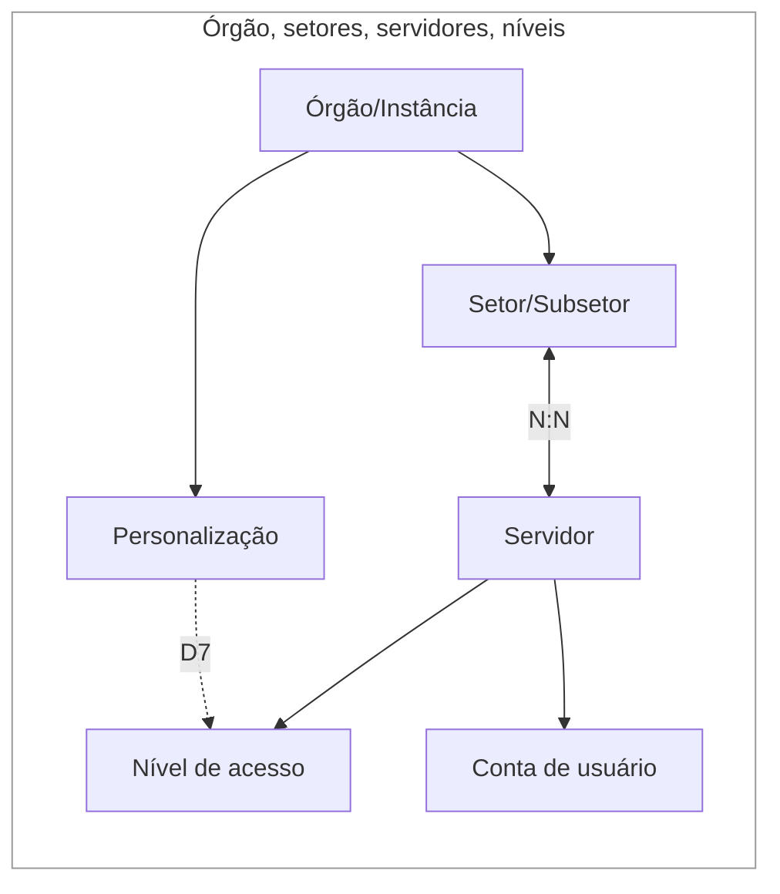
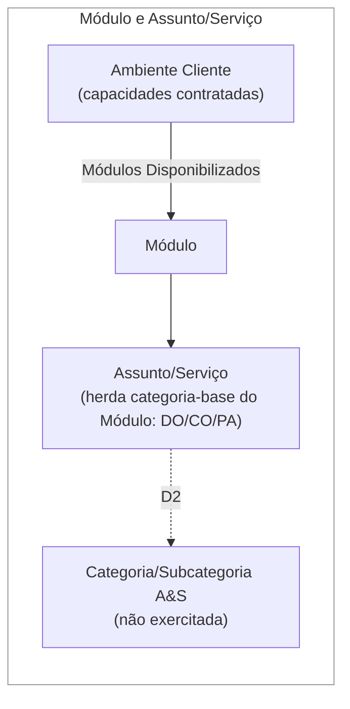
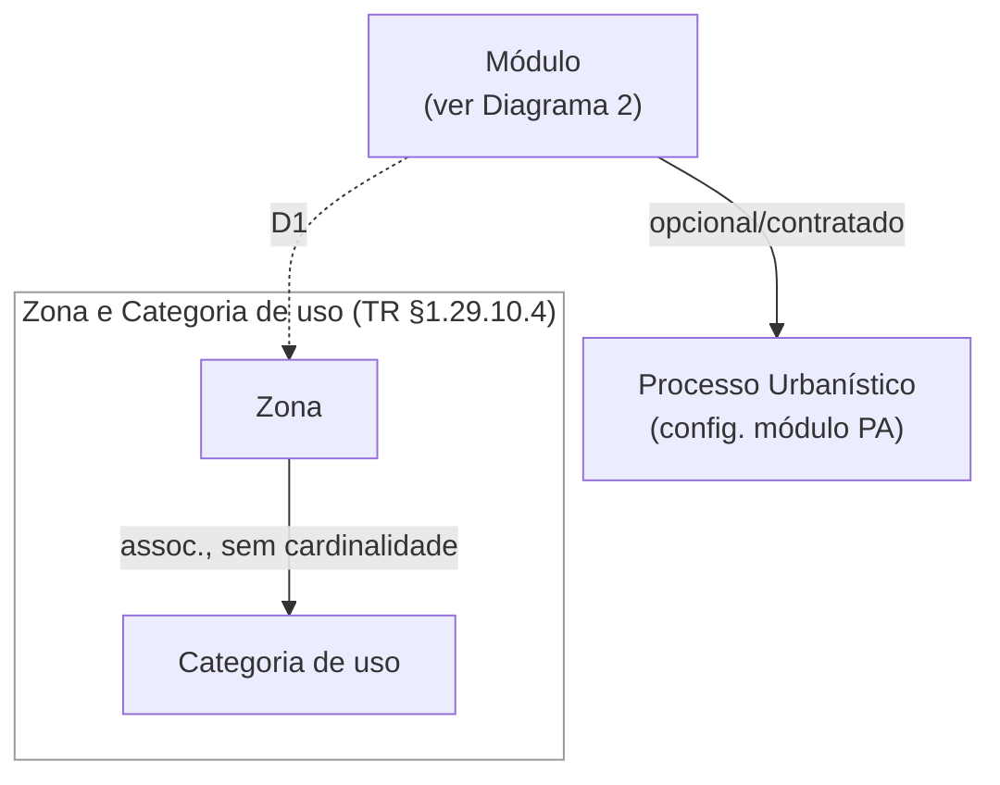
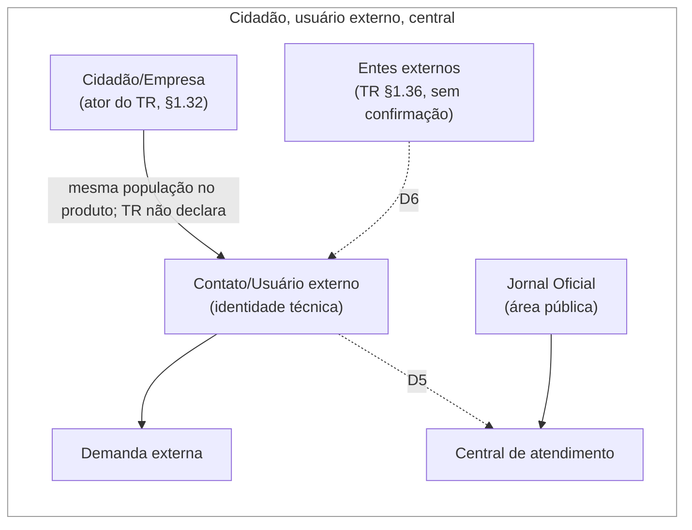
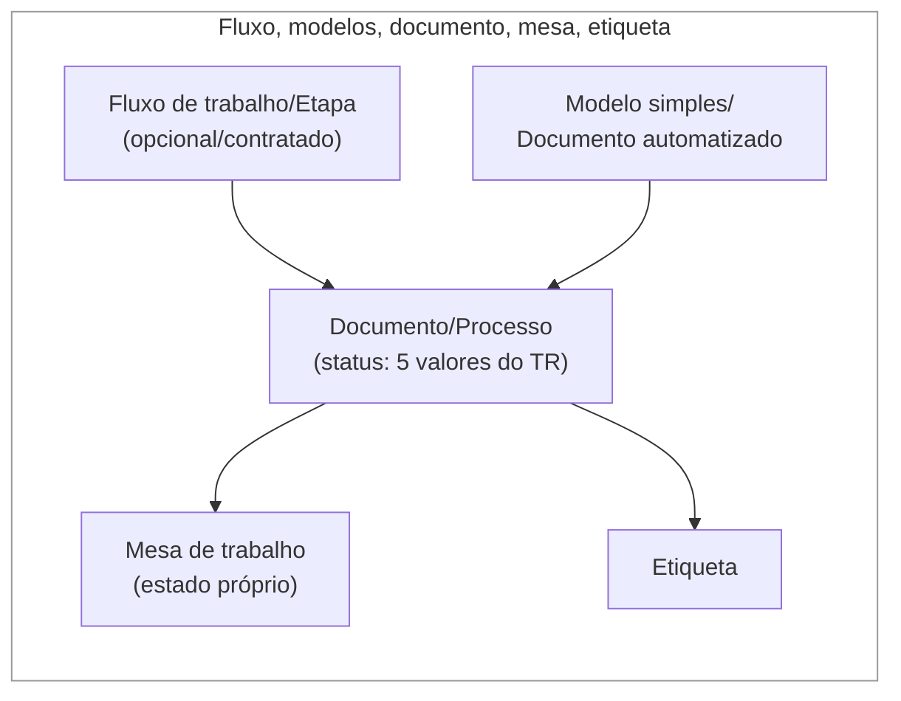
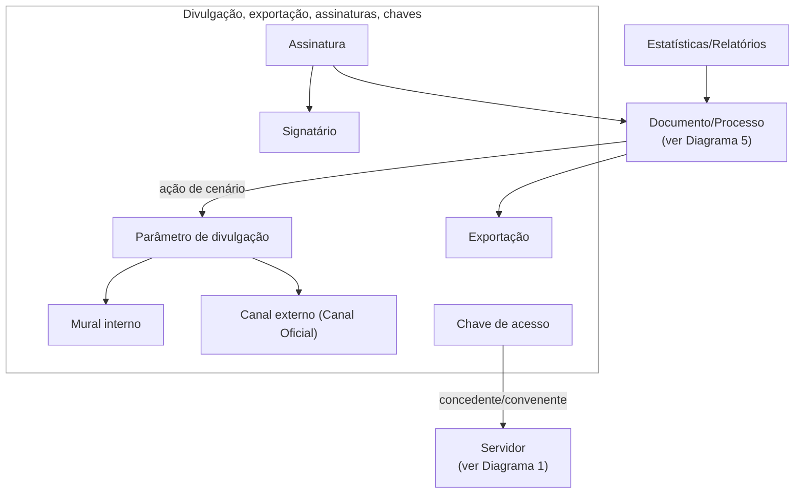

# Modelo-alvo dos dados do SOGOV

Modelo, por entidade, dos atributos, estados e relações necessários para validar o SOGOV em cenários de sanidade, cobrindo o Termo de Referência completo (TR §1.1–1.43). Cada elemento tem origem rastreável no texto do TR e, quando o TR não detalha, na documentação de produto — sempre distinguindo as duas fontes. Este documento **não** decide o canal de fornecimento de cada dado (`.env` individual, seed persistente ou estado criado em cenário) — isso é tratado no documento irmão "Matriz de fornecimento dos dados". Este documento também não cria casos de teste nem implementa preset.

**Autoridade normativa:** o texto do TR (ver "Termo de Referência SOGOV — Transcrição Integral") é a única fonte normativa. Este documento é análise derivada — refina, agrupa e nomeia entidades a partir do TR e do produto, mas nunca substitui o requisito literal.

**Como citamos o TR:** toda referência a um item do TR segue o formato `TR §ID — PDF p. N — transcrição §ID`, remetendo à página do PDF original e ao heading correspondente na transcrição integral.

## 1. Como ler este modelo

Por entidade/ator:

- **Atributos/estados necessários** — o que um cenário de sanidade precisa que a entidade tenha, derivado do texto do TR e, quando o TR não detalha, da documentação de produto (sempre citada como tal).
- **Relações** — vínculos com outras entidades deste modelo.
- **Finalidade para sanidade** — por que essa entidade/atributo importa para um cenário de teste de sanidade (não é uma lista de casos de teste).
- **Fontes** — citação portátil do TR e, quando existir, evidência técnica de automação já observada.
- **Status e incertezas** — o que está **Confirmado** (TR e/ou produto), **Inferido** (dedução razoável, sem declaração literal) ou **A confirmar** (sem evidência suficiente); nada bloqueia o restante do modelo, mas nada é apresentado como certo sem sê-lo.

## 2. Síntese visual

Seis diagramas verticais por assunto, mais uma tabela de orientação. Atributos/estados/ações detalhados vivem só nas tabelas das seções 3–8 — os diagramas mostram só entidades e relações. Se o visualizador não renderizar os blocos Mermaid, as tabelas das seções 3–8 e a tabela de relações (§2.9) abaixo contêm toda a informação equivalente em texto/tabela.

### 2.1 Visão de orientação (sem relações)

| # | Diagrama | Conteúdo principal |
|---|---|---|
| 1 | Órgão, setores, servidores e níveis | Órgão/Instância, Setor, Servidor, Nível de acesso, Conta, Personalização |
| 2 | Módulo e Assunto/Serviço | Módulo com categoria-base, Assunto/Serviço, Categoria/Subcategoria A&S, Ambiente Cliente |
| 3 | Processo Urbanístico e zoneamento | Processo Urbanístico, Zona, Categoria de uso (Módulo aparece como referência) |
| 4 | Atores externos e entrada | Cidadão/Empresa, Contato/Usuário externo, Entes externos, Demanda, Central, Jornal Oficial |
| 5 | Documento, fluxo e mesa | Fluxo/Etapa, Modelo simples/Documento automatizado, Documento/Processo, Mesa, Etiqueta |
| 6 | Divulgação, assinatura, chave e indicadores | Parâmetro de divulgação, canais, Exportação, Assinatura, Signatário, Chave de acesso, Estatísticas |

### 2.2 Diagrama 1 — Órgão, setores, servidores e níveis

### 2.3 Diagrama 2 — Módulo e Assunto/Serviço

> Órgão/Instância (Diagrama 1) → Ambiente Cliente, e Setor (Diagrama 1) → Assunto/Serviço, são relações cruzadas — ver tabela §2.9. Processo Urbanístico, Zona e Categoria de uso ficam no Diagrama 3.

### 2.4 Diagrama 3 — Processo Urbanístico e zoneamento

> `Módulo` aqui é o **mesmo nó de referência** do Diagrama 2 — a aresta `D1` (Módulo↔Zona) é relação entre diagramas, registrada também na tabela §2.9. A relação contratual Ambiente Cliente→Processo Urbanístico ("adicional/contratado") fica só na tabela §2.9, sem duplicar o nó aqui.

### 2.5 Diagrama 4 — Atores externos e entrada

### 2.6 Diagrama 5 — Documento, fluxo e mesa

> Documento/Processo também aparece no Diagrama 6 (divulgação, exportação, assinatura, estatísticas) como nó de referência — relações cruzadas na tabela §2.9.

### 2.7 Diagrama 6 — Divulgação, exportação, assinatura, chave e indicadores

> `Documento/Processo` e `Servidor` aqui são os **mesmos nós de referência** dos Diagramas 5 e 1 — não são entidades duplicadas.

### 2.8 Como ler os diagramas

| Elemento | Significado |
|---|---|
| Linha sólida (`-->`/`<-->`) | Relação sustentada no modelo (TR e/ou produto) — detalhe nas tabelas §3–8 |
| Linha tracejada (`-.->`) | Relação inferida/em aberto — ver "Relações em aberto" (§2.10) |
| ID (`D1`–`D8`) | Identificador curto da relação em aberto |
| "opcional/contratado" | Funcionalidade documentada, não universal — ver Ambiente Cliente, §8 |

D2, D5, D6 e D7 aparecem desenhados (tracejados) dentro do próprio diagrama onde origem e destino coincidem. D1, D3, D4 e D8 cruzam diagramas diferentes — por isso aparecem também (ou só) na tabela "Relações entre os 6 diagramas" (§2.9); D1 é desenhado no Diagrama 3 usando `Módulo` como nó de referência do Diagrama 2.

### 2.9 Relações entre os 6 diagramas

| Relação (origem → destino) | Significado/estado | Ref. |
|---|---|---|
| Órgão/Instância (1) → Ambiente Cliente (2) | Funcionalidades padrão/adicionais contratadas — sólida | §8 |
| Setor/Subsetor (1) → Assunto/Serviço (2) | Regras de tramitação — sólida | §4/§3 |
| Módulo (2) → Zona (3) | **D1** — tracejada, vínculo módulo PA↔zoneamento **A confirmar** (desenhada com nó de referência, §2.4) | TR §1.29.10.4 — PDF p. 11 — transcrição §1.29; §4 |
| Ambiente Cliente (2) → Processo Urbanístico (3) | Funcionalidade adicional/contratada — sólida; relação preservada na tabela, sem duplicar o nó no diagrama | §8 |
| Zona (3) → Documento/Processo (5) | Cidadão/empresa consulta e inicia processo a partir da Zona — sólida | TR §1.29.10.4 — PDF p. 11 — transcrição §1.29; §4 |
| Ambiente Cliente (2) → Fluxo de trabalho/Etapa (5) | Funcionalidade adicional/contratada (Workflow) — sólida | §8 |
| Módulo (2) → Parâmetro de divulgação (6) | Parâmetro de divulgação — sólida | §4/§7 |
| Ambiente Cliente (2) → Estatísticas/Relatórios (6) | Funcionalidade padrão — sólida | §8 |
| Modelo simples/Documento automatizado (5) → Assunto/Serviço (2) | Vinculado a — sólida | §5 |
| Contato/Usuário externo (4) → Conta de usuário (1) | Pertence a — sólida | §3/§6 |
| Central de atendimento (4) → Assunto/Serviço (2) | Oferece acesso a — sólida | §6 |
| Chave de acesso (6) → Servidor (1) | Concedente/convenente — sólida (desenhada com nó de referência, §2.7) | §7 |
| Estatísticas/Relatórios (6) → Servidor (1) | Exibe dados de — sólida | §8 |
| Canal externo (6) → Jornal Oficial (4) | Resulta na área pública — sólida | §7 |
| Documento/Processo (5) → Parâmetro de divulgação (6) | Ato de divulgar, ação de cenário — sólida (desenhada com nó de referência, §2.7) | §7 |
| Documento/Processo (5) → Exportação (6) | É exportado como — sólida | §7 |
| Assinatura (6) → Documento/Processo (5) | É aplicada a — sólida | §7 |
| Estatísticas/Relatórios (6) → Nível de acesso (1) | **D8** — tracejada, nível exato de acesso a estatísticas **A confirmar**; não desenhada em nenhum diagrama | §8/§3 |
| Contato/Usuário externo (4) → Signatário (6) | **D4** — tracejada, correspondência "contribuinte"/signatário externo **A confirmar**; não desenhada em nenhum diagrama | §7 |
| Demanda externa (4) → Documento/Processo (5) | **D3** — tracejada, **Inferido** a partir de evidência técnica; não desenhada em nenhum diagrama | §6 |

### 2.10 Relações em aberto (tracejadas)

| ID | Relação | Onde aparece | Motivo |
|---|---|---|---|
| D1 | Módulo → Zona | Desenhada, Diagrama 3 (cruza Diagramas 2→3) | Vínculo módulo PA↔zoneamento **A confirmar** — não há fonte (TR, produto ou evidência técnica) que o declare |
| D2 | Assunto/Serviço → Categoria/Subcategoria A&S | Desenhada, Diagrama 2 | Estrutura existe tecnicamente, mas nunca exercitada em evidência observada |
| D3 | Demanda externa → Documento/Processo | Só na tabela §2.9 (4→5) | Identidade como Documento comum é **Inferido**, não confirmado |
| D4 | Contato/Usuário externo → Signatário | Só na tabela §2.9 (4→6) | Correspondência "contribuinte"/signatário externo **A confirmar** |
| D5 | Contato/Usuário externo → Central de atendimento | Desenhada, Diagrama 4 | Vínculo exato com Serviço não detalhado pelo TR |
| D6 | Entes externos → Contato/Usuário externo | Desenhada, Diagrama 4 | Identidade própria não confirmada; "Entes externos" citado em TR §1.36 — PDF p. 16 — transcrição §1.36 |
| D7 | Personalização → Nível de acesso | Desenhada, Diagrama 1 | Nível exato de acesso à Personalização **A confirmar** |
| D8 | Estatísticas/Relatórios → Nível de acesso | Só na tabela §2.9 (6→1) | Mesmo motivo de D7, aplicado a Estatísticas |

### 2.11 Notas de leitura

- Categoria-base de Assunto/Serviço é **herdada via o Módulo** ao qual pertence, não campo próprio do Serviço (§4).
- Processo Urbanístico (configuração do módulo PA) e Zona/Categoria de uso (dados, TR §1.29.10.4 — PDF p. 11 — transcrição §1.29) são conceitos distintos que só compartilham contexto no TR — nenhuma seta liga Processo Urbanístico a Assunto/Serviço (§4).
- Só **Zona** origina o processo urbanístico (ação do cidadão/empresa sobre Documento); Categoria de uso só se associa a Zona, nunca origina nada (§4).
- Cidadão/Empresa→Contato/Usuário externo é **Confirmado** pelo produto (mesma população); o texto literal do TR não declara essa equivalência — por isso essa aresta é tracejada numa síntese só-TR, mas sólida aqui (modelo TR+produto).
- Divulgação: o Módulo carrega o parâmetro (persistente); o ato de divulgar um Documento é **ação de cenário** sobre esse parâmetro — não confundir configuração com ação (§7).
- Jornal Oficial é a área pública do canal externo, dentro da Central — não um elemento independente do parâmetro de divulgação (§7).
- Classificação de servidores em Ativos/Inativos (Estatísticas) é **Confirmado** como contexto de negócio; só o cálculo/implementação da estatística em si segue **A confirmar** (§8).
- Ambiente Cliente = capacidades padrão/adicionais contratadas, não uma segunda instância distinta de Órgão/Instância (§8).
- Processo urbanístico (instância) e Anexo (TR §1.29.10.4) são ação/estado sobre Documento/Processo já modelado, não entidades novas (§4).
- Status do Documento (5 valores do TR) e estado da Mesa seguem como dimensões distintas, nunca fundidas num único nó (§5).
- O canal de fornecimento (`.env`/seed/cenário) não é decidido neste documento — ver "Matriz de fornecimento dos dados".

## 3. Órgão, setores, servidores e níveis de acesso

| Entidade | Atributos/estados necessários | Relações | Finalidade para sanidade | Fontes e status | Incertezas |
|---|---|---|---|---|---|
| **Órgão/Instância do Cliente** | Nome, CNPJ, razão social, domínio, licenças, datas de início/término de contrato, módulos contratados — identidade/contrato/licenças ficam só aqui; cores/logos ficam só na Personalização, sem duplicar | Possui Setor/Subsetor; possui Personalização; é a instância ("área de trabalho") do ambiente Cliente | Base dos cenários de personalização visual e de qualquer estatística por órgão | **Confirmado** (TR §1.42 — PDF p. 19 — transcrição §1.42; TR §1.43 — PDF p. 19 — transcrição §1.43); documentação de produto (módulo Ambientes SoGov) confirma instância própria, licenças/contrato no cadastro administrativo | Ator/permissão exata para editar licenças, contrato e módulos contratados (TR §1.42.1 — PDF p. 19 — transcrição §1.42) — **A confirmar**, sem resposta em nenhuma fonte |
| **Setor/Subsetor** | Nome, hierarquia reparentável, setor dono de um módulo/Assunto&Serviço, regras de tramitação herdadas | Servidor↔Setor (N:N); Setor recebe tramitação conforme módulo→Assunto/Serviço→setor | Cenários de permissão de mesa e tramitação por setor, visibilidade sigilosa | **Confirmado** (TR §1.26.5 — PDF p. 2 — transcrição §1.26; TR §1.26.11 — PDF p. 2 — transcrição §1.26); evidência técnica de automação (fatia aprovada, estrutura de setores/subsetores do baseline) | Regras de tramitação detalhadas por setor seguem como documentação de produto reconstruída, ainda não validada por evidência de teste direta |
| **Servidor** | CPF (identificação), nível de acesso, setor(es) vinculados, status de atividade (Em atividade/Licença/Férias/Suspenso), presença online/offline — credencial/autenticação é atributo da Conta de usuário, não duplicada aqui | Servidor↔Setor (N:N, um ou mais setores); Servidor tem Nível de acesso | Ator central de quase todo cenário de tramitação, mesa e assinatura | **Confirmado** (TR §1.26–1.27 — PDF p. 2–7 — transcrição §1.26/§1.27); evidência técnica de automação confirma 5 níveis de acesso no baseline | Bloqueio por 5 tentativas (TR §1.25.1 — PDF p. 2 — transcrição §1.25) e os 4 estados funcionais de atividade são **A confirmar** na automação atual — gap de automação, não indício de ausência no produto |
| **Nível de acesso** | 5 níveis canônicos, do maior para o menor acesso: Administrador, Administrador Setorial, Especialista, Usuário básico, Somente Leitura | Para Assunto/Serviço: Administrador e Administrador Setorial criam, todos os níveis visualizam (**Confirmado** como contexto de negócio). Acesso por nível a personalização e estatísticas é **A confirmar**, não deve ser presumido | Cenários de permissão positiva/negativa em praticamente toda a superfície do TR | **Confirmado** (TR §1.27.2 — PDF p. 3 — transcrição §1.27, 5 níveis: Administrador/Administrador setorial/Assistente administrativo/Auxiliar administrativo/Visualizador) | Representação técnica exata de cada nível e do nível mais baixo ("Somente Leitura"/"Visualizador") segue com nomenclatura dupla entre TR e produto; nível exato autorizado para personalização e estatísticas é **A confirmar** |
| **Conta de usuário** (Servidor/Cidadão/Empresa) | CPF ou CNPJ + senha, ciclo de autenticação, bloqueio por tentativas | Pertence a Servidor, Contato externo PF ou PJ | Cenários de login/cadastro | **Confirmado** (TR §1.24–1.25 — PDF p. 1–2 — transcrição §1.24/§1.25) | Cidadão PF próprio na automação atual ainda reaproveita CPF de servidor — **A confirmar** se isso reflete limite do produto ou só da automação |

## 4. Serviços, assuntos, categorias e documentos

| Entidade | Atributos/estados necessários | Relações | Finalidade para sanidade | Fontes e status | Incertezas |
|---|---|---|---|---|---|
| **Serviço/Assunto** | Nome, categoria vinculada, campos personalizados (diversos tipos, incluindo arquivo, texto grande, texto informativo), abertura externa habilitada/desabilitada, interação do cidadão limitada à abertura | Vinculado a Categoria de documento; setor dono via regras de tramitação | Cenários de criação/tramitação por módulo específico | **Confirmado** (TR §1.28 — PDF p. 7–9 — transcrição §1.28) | Demais tipos de campo personalizado além dos já confirmados por evidência técnica |
| **Categoria de documento** (DO/CO/PA) | 3 categorias-base: Documento oficial, Comunicação oficial, Processo administrativo; o TR também exige categorias específicas (Memorando, Circular, Ofício, Ouvidoria, e-SIC, Ato oficial, Zoneamento) como necessidade do modelo-alvo | Serviço/Assunto vinculado a Categoria | Tipificação do Documento/Processo | **Confirmado** (TR §1.29.1 — PDF p. 9 — transcrição §1.29; demais categorias específicas em TR §1.29.2–1.29.9 — PDF p. 9–11 — transcrição §1.29) | Correspondência técnica das categorias específicas exigidas pelo TR, e estrutura de Categoria/Subcategoria de Assunto&Serviço, seguem **A confirmar** na automação atual |
| **Processo Urbanístico** | Parametrização/característica de um módulo do tipo Processo administrativo, não categoria-base própria; é funcionalidade **adicional/contratada**, não padrão universal do ambiente Cliente | Módulo do tipo Processo administrativo pode ativar Processo Urbanístico | Cenários do módulo quando o contrato inclui essa funcionalidade | **Confirmado** no produto (parametrização de módulo); TR §1.29.10 — PDF p. 11 — transcrição §1.29 não declara a categoria-base explicitamente — essa correspondência é só **Inferido**/esclarecimento de produto | Zona/Categoria de uso não localizadas na automação atual |
| **Zona** (TR §1.29.10.4 — PDF p. 11 — transcrição §1.29) | Nome, descrição, bairros/localidades, categorias de uso associadas, arquivo georreferenciado, estado de publicação (publicado/não publicado), histórico completo de criação/edição/associações/dissociações — necessidade declarada pelo TR, **distinta** da configuração de ativação do módulo (linha Processo Urbanístico acima) | Associada a Categoria de uso (o TR não explicita multiplicidade N:N); upload de arquivo sobrescreve Zonas já existentes. **Vínculo com o módulo que ativa "processo urbanístico" (onde esses registros ficam armazenados) é A confirmar — não há fonte que o declare** | Cenário de consulta pública de uma Zona publicada, e de abertura de Processo urbanístico a partir dela — essa abertura é **ação de cenário sobre a entidade Documento/Processo já modelada (§5)**, não uma entidade persistente própria | **Confirmado** pelo TR (TR §1.29.10.4 — PDF p. 11 — transcrição §1.29) | Nenhuma evidência técnica de automação localizada — **não presumir ausência no produto**; vínculo de armazenamento com o módulo é hipótese **A confirmar**; categoria-base do módulo que os contém segue **A confirmar** pelo texto do TR |
| **Categoria de uso** (TR §1.29.10.4 — PDF p. 11 — transcrição §1.29) | Nome, descrição, parâmetros (unidade de medida + valor), histórico completo de criação/edição — necessidade declarada pelo TR | Associada a Zona (o TR não explicita multiplicidade N:N) | Base para consulta/gestão dos usos permitidos numa Zona | **Confirmado** pelo TR | Nenhuma evidência técnica de automação localizada — **não presumir ausência no produto** |

> **Nota — Processo urbanístico (instância) e Anexo** (TR §1.29.10.4 — PDF p. 11 — transcrição §1.29): o TR confirma que um Cidadão/Empresa inicia, a partir de uma Zona, um Processo urbanístico, e que um Anexo desse processo é revisado/aprovado/reprovado por Servidor com permissão. Isso é tratado aqui como **ação de cenário sobre a entidade Documento/Processo já modelada em §5**, não uma entidade persistente nova. O estado de revisão do Anexo (revisado/aprovado/reprovado) é específico desse fluxo e é **A confirmar** na automação atual.

## 5. Fluxo de trabalho, modelos, mesa e tramitação

| Entidade | Atributos/estados necessários | Relações | Finalidade para sanidade | Fontes e status | Incertezas |
|---|---|---|---|---|---|
| **Fluxo de trabalho / Etapa** | Status (ativo/inativo/rascunho), Etapa com nome/setor responsável/regras de tramitação, despacho customizado com assinatura opcional, tipo de assinatura exigido por etapa | Fluxo→Etapa; Etapa pode gerar Despacho; Documento tramita conforme Etapa/setor | Cenários de tramitação configurada por fluxo (distinto de mesa fora do fluxo) | **Confirmado** (TR §1.30 — PDF p. 11–12 — transcrição §1.30) | Regras de transição de etapa (TR §1.30.3 — PDF p. 12 — transcrição §1.30) são **A confirmar** na automação atual; correspondência do tipo de assinatura por etapa com a taxonomia do produto segue **A confirmar** |
| **Modelo simples / Documento automatizado** | Nome, definição de herança de dados sim/não, estilização de cabeçalho/rodapé, conteúdo herdado, validade pré-definida | Vinculado a Categoria/Serviço/Assunto; gera Documento/Processo | Cenários de criação de documento a partir de modelo | **Confirmado** (TR §1.31 — PDF p. 12–13 — transcrição §1.31) | Histórico de alterações do modelo e edição/exclusão com histórico são **A confirmar** na automação atual; validade pré-definida é exigida pelo TR mas não foi observada como ativa na configuração padrão da automação atual |
| **Documento/Processo** | **Dados/estados necessários:** status do Documento/Processo (5 valores do TR: Em aberto, Em elaboração, Em tramitação, Pausado, Encerrado); estado individual da Mesa como dimensão distinta (**A confirmar** tecnicamente); histórico/versões; prazos associados (oficial/documento/individual/assinatura). **Ações de cenário que usam a entidade** (não são dados que o preset precisa carregar): receber despacho; ser retificado; receber solicitação de revisão; ser editado; ser encerrado; gerar documento associado automaticamente | Pertence a Mesa de trabalho; recebe Etiqueta; gera Despacho; é alvo de Assinatura/Divulgação/Exportação | Entidade central de praticamente todos os cenários de sanidade de tramitação | **Confirmado** (TR §1.35 — PDF p. 14–16 — transcrição §1.35) | Identidade despacho-de-etapa × despacho-de-tramitação, e documento apensado × associado automaticamente, seguem **A confirmar**; alguns subcampos (data de criação, setor, visualizações da timeline — TR §1.35.1 — PDF p. 14 — transcrição §1.35) sem evidência técnica localizada |
| **Mesa de trabalho** | **Dados/configuração persistente necessários:** preferência de exibição Pausado/Encerrado por usuário; vínculo Servidor↔Setor que determina quais documentos aparecem na mesa. **Comportamentos de cenário** (ação/consulta de teste, não dado de preset): visualização Kanban/Lista; alternância de setor ativo; acesso a mesas alheias; filtros/busca/ordenação; rastreio global; busca em outras mesas vinculadas | Mostra Documento conforme vínculo Servidor↔Setor e regras de tramitação | Cenário de acesso à mesa conforme setor do servidor, incluindo permissão negativa/positiva | **Confirmado** (TR §1.33 — PDF p. 13–14 — transcrição §1.33) | Estado da Mesa como entidade própria é **A confirmar** tecnicamente; teste de negação de acesso é **A confirmar** |
| **Etiqueta** | Nome/cor; pessoal (uso individual) vs. compartilhada por setor; subetiqueta; histórico | Etiqueta↔Documento | Cenários de organização/filtro de documentos na mesa | **Confirmado** (TR §1.34 — PDF p. 14 — transcrição §1.34) | Reflexo de alteração/exclusão de etiqueta em documentos já etiquetados (TR §1.34.2.4 — PDF p. 14 — transcrição §1.34) é **A confirmar** na automação atual |

## 6. Atores externos, cidadão e atendimento

| Entidade | Atributos/estados necessários | Relações | Finalidade para sanidade | Fontes e status | Incertezas |
|---|---|---|---|---|---|
| **Contato externo PF/PJ = Usuário externo** | CPF/CNPJ + senha; cadastro único com rejeição de duplicata; confirmação de cadastro por e-mail | Abre Demanda externa; pode corresponder a Signatário externo (correspondência **A confirmar**) | Cenários de cadastro e abertura de solicitação externa | **Confirmado** (TR §1.32 — PDF p. 13 — transcrição §1.32; TR §1.37 — PDF p. 16 — transcrição §1.37) | Cadastro único/auto-registro de pessoa física é **A confirmar** na automação atual |
| **Demanda externa** | Interação limitada à abertura; estado Pausada/Encerrada | Usuário externo abre Demanda; se Demanda é entidade própria ou um Documento/Processo comum de origem externa é **Inferido**, não confirmado | Cenário de solicitação aberta por cidadão e seu acompanhamento | **Confirmado** pelo TR (TR §1.37 — PDF p. 16 — transcrição §1.37) | Estado Pausada/Encerrada é **A confirmar** por evidência técnica direta |
| **Central de atendimento / Canal Oficial** | Abertura externa habilitada/desabilitada; "canais digitais do órgão" **A confirmar** tecnicamente | Central oferece acesso a Serviço. Divulgação de Documento usa um único parâmetro/funcionalidade do módulo, com **dois canais de destino independentes**: mural interno, ou canal externo (termo do TR: Canal Oficial) — o canal externo resulta numa área pública de acesso dentro da Central, o **Jornal Oficial**. É uma hierarquia única (parâmetro → canal → área de acesso), não dois elementos independentes | Cenário de acesso do cidadão aos serviços do órgão | **Confirmado** (TR §1.36 — PDF p. 16 — transcrição §1.36) | O TR menciona Entes externos como terceiro tipo de ator (TR §1.36 — PDF p. 16 — transcrição §1.36); identidade/perfil no produto e correspondência com Contato/Usuário externo são **A confirmar** |

## 7. Divulgação, exportação, assinaturas e chaves de acesso

| Entidade | Atributos/estados necessários | Relações | Finalidade para sanidade | Fontes e status | Incertezas |
|---|---|---|---|---|---|
| **Divulgação** | Parâmetro único do módulo habilitando divulgação (configuração persistente, enviada na criação); a partir desse parâmetro, dois canais de destino independentes — mural interno e canal externo, que resulta na área pública Jornal Oficial (sem login) | Documento → Divulgação (parâmetro) → canal (mural interno ou canal externo); canal externo → área pública Jornal Oficial, dentro da Central de atendimento | Cenário de publicação de documento e verificação do acesso público do cidadão | **Confirmado** (TR §1.38 — PDF p. 16–17 — transcrição §1.38) | Acesso público sem login é documentado no produto, mas **A confirmar** por evidência de teste automatizado |
| **Exportação** | Documento existente simples (base); árvore composta — anexos, despachos, associação, assinaturas combinados | Documento → Exportação (PDF/árvore) | Cenário de exportação de um documento já existente | **Confirmado** (TR §1.39 — PDF p. 17 — transcrição §1.39) | Cobertura conjunta da árvore composta não deve ser inferida a partir de casos isolados — **A confirmar** |
| **Assinatura / tipo de assinatura** | Tipos: eletrônica simples, avançada, qualificada; página extra de assinaturas — ativada por configuração no módulo, herdada por Assunto/Serviço com opção de desmarcar | Assinatura é aplicada a Documento; Assinatura tem Signatário | Representa o requisito de autenticação/verificação de autenticidade do TR | **Confirmado** (TR §1.40.1–1.40.2 — PDF p. 17–18 — transcrição §1.40) | Taxonomia exata de tipos de assinatura e correspondência com a nomenclatura do produto seguem **A confirmar**; página extra sem cobertura confirmada por evidência técnica |
| **Solicitação de assinatura / Signatário** | Signatário interno (setor) / externo (cidadão); execução sequencial na ordem escolhida (bloqueio até a vez); locais de assinatura no documento; edição/exclusão de signatário pendente; recusa simples e recusa em cascata (só cancela signatários posteriores, mantém os anteriores já concluídos); assinatura em massa | Solicitação de assinatura → Signatário; Signatário pode ser Servidor ou Contato externo | Cenários de fluxo de assinatura, recusa e (extensão) edição/massa | **Confirmado** (TR §1.40.3–1.40.6 — PDF p. 18 — transcrição §1.40) | "Contribuinte" como ator distinto do Signatário externo é **A confirmar**; bloqueio até a vez não exercitado por evidência de teste direta |
| **Chave de acesso** | Concedente/convenente; período/limite de uso; módulo autorizado; setor distinto; encerramento automático/manual; histórico/contadores | Chave vincula Servidor (concedente) a Servidor (convenente); Chave pode gerar Documento | Cenário de criação delegada de documento via chave | **Confirmado** (TR §1.41 — PDF p. 18–19 — transcrição §1.41) | Correspondência entre nível "Visualizador" do TR e "Somente leitura"/outra nomenclatura do produto já é tratada como **Confirmado** em outra análise; não reaberta aqui |

## 8. Personalização, ambientes e estatísticas

| Entidade | Atributos/estados necessários | Relações | Finalidade para sanidade | Fontes e status | Incertezas |
|---|---|---|---|---|---|
| **Personalização/identidade visual** | Cores primária/secundária; logo/brasão/banner (variantes dark); edição exige nível Administrador | Órgão possui Personalização | Cenário de edição de identidade visual do órgão | **Confirmado** (TR §1.42.1 — PDF p. 19 — transcrição §1.42) | Acesso aos dados cadastrais do órgão — só leitura ou também edição — é **A confirmar**; exigência de nível Administrador é documentada, mas **A confirmar** por evidência de teste |
| **Ambiente Cliente (instância)** | Funcionalidades padrão: Cadastro/Gerenciamento de Usuários, Organograma, Relatórios/Estatísticas, Módulos Disponibilizados, Etiquetas; funcionalidades adicionais contratadas: Workflow, Processos Urbanísticos | Cliente tem instância própria | Delimita o que é padrão vs. contratado em qualquer cenário do ambiente Cliente | **Confirmado** no produto (documentação de produto, módulo Ambientes SoGov); TR §1.42–1.43 — PDF p. 19 — transcrição §1.42/§1.43 não nomeia o conceito "Ambiente Cliente" diretamente — classificação padrão/contratado é esclarecimento de produto | Escopo/código ainda **A confirmar** por evidência de teste automatizado |
| **Estatísticas/Relatórios** | Dimensões de relatório pedidas pelo TR (setores/módulos/servidores/consumo); status estatístico de servidor agrupado em Ativos (Em atividade/Licença/Férias) e Inativos (Suspenso) — mapeamento de negócio **Confirmado**, cálculo/implementação **A confirmar** | Estatísticas exibem dados de Servidor e Documento; é funcionalidade padrão do ambiente Cliente | Representa a necessidade de relatório pedida pelo TR, como base do modelo-alvo | **Confirmado** (TR §1.43 — PDF p. 19–20 — transcrição §1.43) | Catálogo de relatórios, regras de cálculo e papéis autorizados ("administradores e usuários autorizados", termo do TR) seguem sem nome canônico em nenhuma fonte — **A confirmar** |

## 9. Relações entre grupos

Já registradas nas seções 2–8 acima; nenhuma relação nova é introduzida aqui.

## 10. Incertezas que não bloqueiam este modelo

Resumo das principais lacunas (detalhe completo por entidade, nas seções 3–8 acima):

- Vínculo de armazenamento entre módulo PA e Zona/Categoria de uso: **A confirmar**.
- Correspondência "contribuinte"/Signatário externo: **A confirmar**.
- Nível exato autorizado para personalização e estatísticas: **A confirmar**.
- Taxonomia de tipos de assinatura do produto vs. termos do TR: **A confirmar**.
- Nenhuma dessas questões exige decisão agora — ficam marcadas, por entidade, nas tabelas acima.

## 11. Fornecimento de dados

Este documento define **o que** cada entidade precisa (atributos, estados, relações). O mapeamento campo a campo de **como** esse dado chega ao ambiente de teste (`.env` individual, seed persistente, ou estado criado durante o cenário) é tratado no documento irmão "Matriz de fornecimento dos dados". Cada atribuição de canal ali é **hipótese candidata**, não decisão de arquitetura — a preparação técnica final continua etapa futura.
