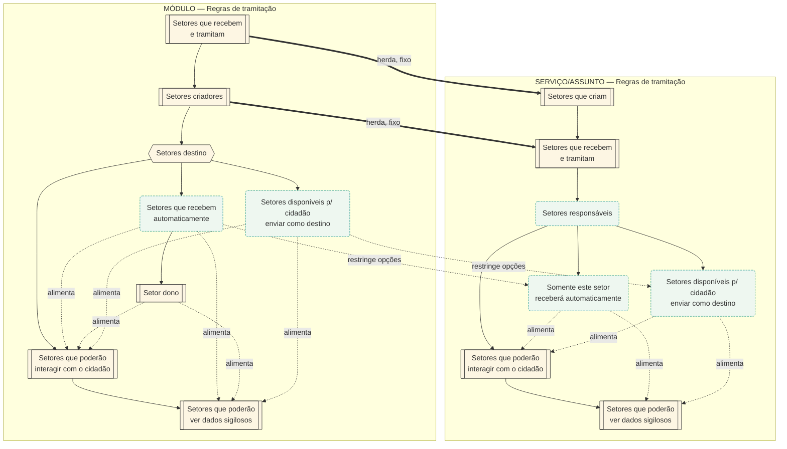
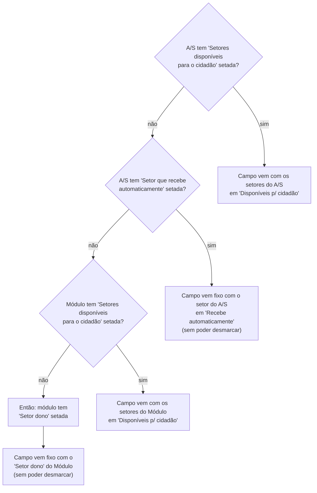

# Regras de Tramitação

> [!info] Origem
> Reconstruído a partir de um diagrama (imagem) deixado em `~/Downloads/Tramitação diagrama.webp` — sem metadados de página do Notion (veio como imagem solta, não como export `.md`). Cópia da imagem original preservada em [`Regras de Tramitação - diagrama original.webp`](Regras%20de%20Tramita%C3%A7%C3%A3o%20-%20diagrama%20original.webp) (mesma pasta), pra conferência visual. Os dois diagramas Mermaid abaixo foram redesenhados a partir da leitura integral da imagem (zoom box a box) — a estrutura e o texto de cada regra foram conferidos, não apenas a view geral.

## Visão geral
- Regras de tramitação definem **quais setores** participam da tramitação de um documento, em dois níveis que se herdam: **Módulo** (regra-mãe, define o teto do que é possível) e **Serviço/Assunto** (regra-filha — pode restringir o que o módulo permite, nunca ampliar).
- Cobre dois problemas distintos: (1) quais setores recebem, criam e tramitam o documento, interagem com o cidadão ou veem dados sigilosos; e (2) qual setor aparece pré-selecionado no campo "setor destinatário" quando um cidadão externo abre uma demanda — a **Regra do setor destinatário**, um algoritmo de prioridade à parte (Diagrama 2).
- Citada em [[QA Workspace/04 Conhecimento/Módulos/Construtor de Módulos#Vincular cliente|Construtor de Módulos → Vincular cliente]], onde essas mesmas regras são configuradas no momento de vincular um módulo a um cliente.

## Diagrama 1 — Hierarquia de setores (Módulo × Serviço/Assunto)

> [!tip] Legenda
> Caixa dupla = obrigatório · Caixa arredondada tracejada = opcional · Seta cinza tracejada "alimenta" = soma setores automaticamente em outra regra · Seta tracejada "restringe opções" = o que foi marcado no módulo limita as opções disponíveis no A/S · Seta grossa "herda, fixo" = o A/S recebe os setores do módulo já marcados, sem poder desmarcar.

## Diagrama 2 — Regra do setor destinatário (prioridade em cascata)

> [!note] Por que a 4ª pergunta não tem ramo "não"
> "Setores destino" é **obrigatório** no módulo — pelo menos um dos dois subitens ("recebe automaticamente" ou "disponível p/ cidadão") precisa estar marcado. Se os três primeiros "não" acontecerem (nem o A/S nem o módulo têm "disponível p/ cidadão" setada, e o A/S não tem "recebe automaticamente"), a única possibilidade que sobra é o módulo ter marcado "recebe automaticamente" — e, por tabela, "Setor dono" (condicionado a ela) também está setado. Por isso o algoritmo sempre termina numa resposta.

## Regras de negócio

### Módulo — Setores que recebem e tramitam (obrigatório)
- Primeira regra a ser definida. O usuário escolhe entre todos os setores da organização, quantos quiser.
- Os setores selecionados aqui poderão ser envolvidos na tramitação dos documentos do módulo.

### Módulo — Setores criadores (obrigatório)
- Condicionada à regra anterior: só exibe (e permite escolher) os setores já selecionados em "Setores que recebem e tramitam".
- Os setores definidos aqui serão os **únicos** que poderão criar documentos no módulo.

### Módulo — Setores destino (cluster obrigatório, com 2 subitens opcionais)
- O cluster em si é obrigatório, mas as regras internas são opcionais — o usuário só precisa marcar **uma delas**, obrigatoriamente (pode marcar as duas).

#### Setores que recebem automaticamente (opcional)
- Só exibe setores já selecionados em "Setores que recebem e tramitam".
- Opcional, mas se algum setor for marcado aqui, **obrigatoriamente** a subregra "Setor dono" precisa ser preenchida.
- Setores marcados aqui recebem, automaticamente, todos os documentos criados no módulo.

#### Setor dono (obrigatório, condicionado à anterior)
- Só existe/é obrigatória se "Setores que recebem automaticamente" teve alguma seleção.
- Só exibe setores já selecionados em "Setores que recebem automaticamente".
- O setor escolhido aqui vira, automaticamente, o **dono** dos documentos do módulo.

#### Setores disponíveis para o cidadão enviar como setor destino (opcional)
- Só exibe setores já selecionados em "Setores que recebem e tramitam".
- Os setores marcados aqui aparecem no select de setor destinatário quando um usuário externo abre uma demanda (pelo módulo em questão) na central de atendimento de algum órgão.

### Módulo — Setores que poderão interagir com o cidadão (obrigatório)
- Só exibe setores já selecionados em "Setores que recebem e tramitam".
- Serão os **únicos** setores que podem interagir diretamente com o usuário externo nos documentos do módulo — via despachos, respostas e solicitação de assinaturas.

### Módulo — Setores que poderão ver dados sigilosos (obrigatório)
- Só exibe setores já selecionados em "Setores que recebem e tramitam".
- Serão os únicos que podem ver os dados do solicitante e o conteúdo da abertura do documento quando a demanda for aberta de forma sigilosa.

> [!important] Pré-seleção automática (vale pras duas regras acima)
> As regras "Interagir com o cidadão" e "Ver dados sigilosos" vêm com os seguintes setores pré-selecionados automaticamente:
> - os setores de "Setores que recebem automaticamente" (se essa regra foi setada);
> - o setor de "Setor dono";
> - os setores de "Setores disponíveis para o cidadão enviar como setor destino" (se essa regra foi setada).
>
> Os setores herdados podem ser desmarcados, **exceto** o setor definido em "Setor dono".

### Serviço/Assunto — espelha o módulo, com herança
- **Setores que criam** (obrigatório): traz os setores setados em "Setores criadores" do módulo, já selecionados. Podem ser desmarcados, mas precisa sobrar **pelo menos 1**.
- **Setores que recebem e tramitam** (obrigatório): traz **todos** os setores setados em "Setores que recebem e tramitam" do módulo. **Adicionalmente**, traz já marcados — **sem opção de desmarcar** — os setores selecionados em "Setores que criam" do próprio serviço/assunto.
- **Setores responsáveis** (opcional): cluster equivalente ao "Setores destino" do módulo — totalmente opcional a nível de A/S. Se nada for setado aqui, vale o que foi setado a nível de módulo.
	- **Somente este setor receberá automaticamente** (opcional): só exibe setores já setados em "Setores que recebem e tramitam" do A/S. Regra opcional — se nada for setado, respeita a regra pré-estabelecida a nível de módulo; se algum setor for setado aqui, o encaminhamento pros setores do módulo continua sendo respeitado, **mas o setor dono do documento passa a ser o setor selecionado aqui** — não mais o que foi setado a nível de módulo.
	- **Setores disponíveis para o cidadão enviar como setor destino** (opcional): só exibe setores já setados em "Setores que recebem e tramitam" do A/S. Se nada for setado aqui, deve ser obedecido o que foi setado a nível de módulo.
- **Setores que poderão interagir com o cidadão** (obrigatório) e **Setores que poderão ver dados sigilosos** (obrigatório): só exibem setores já setados em "Setores que recebem e tramitam" do A/S. Devem ficar selecionados automaticamente: os setores de "Somente este setor receberá automaticamente" (se setada) + os setores de "Setores disponíveis para o cidadão enviar como setor destino" (se setada). Podem ser desselecionados, desde que fique pelo menos 1 setor de alguma das regras mencionadas.

### Regra do setor destinatário (ver Diagrama 2)
Define, em cascata de prioridade, o que aparece pré-selecionado no campo "setor destinatário" quando um cidadão externo abre uma demanda pela central de atendimento:
1. A/S tem "Setores disponíveis para o cidadão" setada → usa esses.
2. Senão, A/S tem "Setor que recebe automaticamente" setada → usa esse, fixo (sem desmarcar).
3. Senão, Módulo tem "Setores disponíveis para o cidadão" setada → usa esses.
4. Senão → usa o "Setor dono" do módulo, fixo (sem desmarcar) — sempre existe nesse ponto, porque "Setores destino" é obrigatório no módulo.

## Comportamentos observados em teste
<!-- O que foi aprendido validando: comportamentos não documentados, pegadinhas, efeitos colaterais -->
- Ainda não testado — este fluxo é reconstrução de diagrama, não validação em ambiente.

## Dúvidas em aberto
- [ ] A imagem original não tem URL nem metadados de página do Notion (não veio como export `.md`) — não dá pra saber em qual página do Notion esse diagrama vive, nem a data da última edição. Encontrando a página de origem, completar `fonte`/`fonte_criado`/`fonte_ultima_edicao` no frontmatter.
- [ ] Nenhum SGV ou task vinculada ao diagrama — parece ser documentação de referência pura (regra de produto já implementada), não uma entrega específica em aberto.

## Cards relacionados
<!-- SGVs validados que tocam este módulo -->
- Sem SGV vinculado — documentação de referência.

## Referências
<!-- Docs do repo (caminho), links externos, leis -->
- Imagem original: [`Regras de Tramitação - diagrama original.webp`](Regras%20de%20Tramita%C3%A7%C3%A3o%20-%20diagrama%20original.webp) (mesma pasta).
- [[QA Workspace/04 Conhecimento/Módulos/Construtor de Módulos|Construtor de Módulos]] — seção "Vincular cliente" configura estas mesmas regras de tramitação ao vincular um módulo a um cliente.
